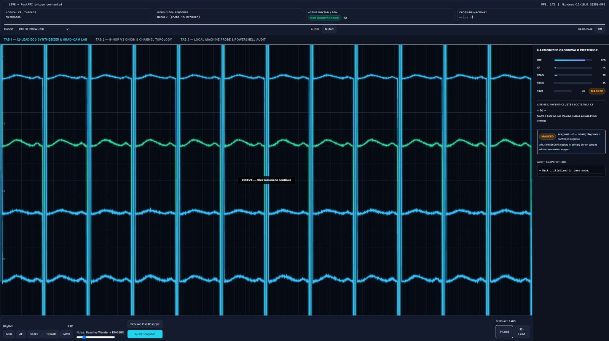
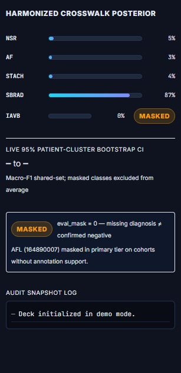
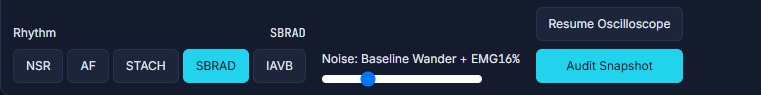
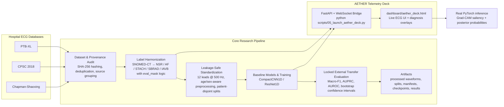

# Cross-Database Evaluation of Deep Learning for ECG Arrhythmia Classification Using Harmonized Labels

**Author:** BISHESH KUMAR DAS  
**Institution:** Sikkim Manipal Institute of Technology  
**Proposal Date:** 5 October 2026  

## Current status: prototype demo





The AETHER Telemetry Deck runs locally: `python scripts/05_launch_aether_deck.py`, then open http://127.0.0.1:8765.
These screenshots show the UI prototype. This demo is not verified trained-model inference: the training pipeline is still under repair, so any predictions or scores shown are demo values, not validated accuracy or medical results.

---

## How to Run

### Installation

The project declares Python >= 3.10 (from `pyproject.toml`) and its dependencies in `requirements.txt`.

```powershell
cd ecg-cross-db-harmonization
python -m venv .venv
.venv\Scripts\activate
pip install -r requirements.txt
pip install -e .
```

### Research Pipeline Entry Points

The following scripts are runnable CLI entry points defined with `argparse` in `scripts/`:

| Script | Command | Status | Notes |
|---|---|---|---|
| **Dataset Audit** | `python scripts/01_run_dataset_audit.py` | tested | Loads cohort config from `configs/datasets/cohorts.yaml`; lists 3 candidate databases (PTB-XL, CPSC 2018, Chapman-Shaoxing). |
| **Harmonize & Split** | `python scripts/02_harmonize_and_split.py` | tested | Loads primary crosswalk from `configs/crosswalk/label_crosswalk_v1.csv`; outputs canonical classes [`AF`, `IAVB`, `NSR`, `SBRAD`, `STACH`]. |
| **Train Baselines** | `python scripts/03_train_baselines.py` | tested | Uses `--config configs/experiments/locked_protocol.yaml` and `--seed` (default: 42). |
| **Transfer Evaluation** | `python scripts/04_evaluate_transfer.py` | tested | Verifies locked protocol: asserts `allow_target_labels_in_transfer` and `allow_target_driven_tuning` are `False`. |
| **Aether Deck Bridge** | `python scripts/05_launch_aether_deck.py` | inspected, not tested | Launches FastAPI + WebSocket bridge at `http://127.0.0.1:8765`. Falls back to seed-42 initialized models and synthetic windows when no checkpoint exists. See dashboard section for details. |

### Dashboard (AETHER Telemetry Deck)

- **FastAPI bridge**: `python scripts/05_launch_aether_deck.py` serves `dashboard/aether_deck.html` at `http://127.0.0.1:8765`
- Endpoints: `GET /`, `GET /telemetry`, `GET /crosswalk`, `GET /eval`, `POST /model/{architecture}/predict`
- Falls back to seed-42 model initialization and synthetic ECGs when no checkpoint is present in `models/`

--- 

## 1. Project Title, Author & Overview

**Title:** Cross-Database Evaluation of Deep Learning for ECG Arrhythmia Classification Using Harmonized Labels

**Author:** BISHESH KUMAR DAS — Sikkim Manipal Institute of Technology

### Overview

This repository implements a **locked, reproducible benchmark** for answering one central research question:

> *How well do deep learning 12-lead ECG arrhythmia classifiers generalize across independently collected hospital databases?*

The answer is tested by harmonizing labels from three very different sources — **PTB-XL**, **CPSC 2018**, and **Chapman-Shaoxing** — into a single shared taxonomy of five canonical rhythm classes:

| Canonical Class | SNOMED-CT Concept | Role |
| :--- | :--- | :--- |
| `NSR` | 426783006 | Sinus rhythm — the **comparator** (not an arrhythmia) |
| `AF` | 164889003 | Atrial fibrillation |
| `STACH` | 427084000 | Sinus tachycardia |
| `SBRAD` | 426177001 | Sinus bradycardia |
| `IAVB` | 270492004 | First-degree atrioventricular block |

### System Architecture Overview



### Plain-English Summary

Hospitals record heart rhythms with their own conventions, and some never record a given rhythm at all. The pipeline therefore **harmonizes** raw SNOMED-CT codes into the shared classes above, and when a diagnosis is missing or uncertain it applies an explicit **`eval_mask = 0`** — i.e., the class is *masked out* of the evaluation — **rather than silently treating a missing diagnosis as a "confirmed negative."** This keeps the benchmark scientifically honest and auditable.

The same harmonized data pipeline powers two surfaces:

1. **Core Research Pipeline** (`src/ecg_xval/`, `scripts/01`–`04`) — auditing, harmonization, modeling, and locked transfer evaluation.
2. **AETHER Telemetry Deck** (`dashboard/aether_deck.html`, `scripts/05_launch_aether_deck.py`) — the interactive real-time visualization and live-inference layer built on top of the same harmonized concepts.

---

## 2. Key Functionalities (Simple & Structured Breakdown)

The repository has **two complementary halves**.

### A. Core Research Pipeline (`src/ecg_xval/` & `scripts/01`–`04`)

| # | Stage | Module(s) | Purpose |
| :- | :--- | :--- | :--- |
| 1 | **Dataset & Provenance Auditing** | `src/ecg_xval/audit/`, `scripts/01_run_dataset_audit.py` | Detects duplicate waveforms (SHA-256 hashing) and groups records by hospital origin. |
| 2 | **Versioned Label Harmonization** | `configs/crosswalk/`, `src/ecg_xval/harmonization/` | Maps raw SNOMED-CT codes → 5 canonical classes with explicit per-class eligibility / `eval_mask` rules. |
| 3 | **Leakage-Safe Standardization & Splitting** | `src/ecg_xval/preprocessing/`, `src/ecg_xval/partitioning/` | Standardizes to **12 leads @ 500 Hz** (10 s windows, mV units), fits normalizers on training data only, enforces patient-disjoint splits. |
| 4 | **Locked External Transfer & Bootstrap Evaluation** | `src/ecg_xval/evaluation/`, `scripts/04_evaluate_transfer.py` | Computes Macro-F1, AUPRC, AUROC (absent classes marked `"not estimable"`), plus 95% patient-cluster bootstrap CIs. |

### B. AETHER Real-Time Telemetry & Visual Studio (`dashboard/aether_deck.html` & `scripts/05_launch_aether_deck.py`)

**Two modes:**

- **Standalone Demo Mode** — the deck runs directly in any modern browser from `file://` with **zero server setup**: 60 FPS clinical oscilloscope, rhythm synthesis, noise/drift injection, posterior panel, onion simulator, and machine probe.
- **Live Bridge Mode** — `python scripts/05_launch_aether_deck.py` launches a FastAPI + WebSocket bridge on `http://127.0.0.1:8765` serving the dashboard and streaming **real PyTorch inference (Grad-CAM bands, posterior probabilities)**, plus **Windows host telemetry**.

**Three interactive tabs in the deck:**

1. **Tab 1 — 12-Lead ECG Synthesizer & Grad-CAM Lab** — 60 FPS clinical grid + waveform oscilloscope, rhythm switcher, baseline-drift/EMG noise injector, Grad-CAM saliency overlay, and live crosswalk posterior bars with `MASKED` badges.
2. **Tab 2 — 6-Hop v3 Onion & Channel Topology Simulator** — interactive cryptographic relay visualizer with packet animation.
3. **Tab 3 — Local Machine Probe & PowerShell Audit** — real-time CPU/GPU hardware detection, floating-point stress test, one-click read-only PowerShell audit command.

---

## 3. Complete Repository Directory Structure

```text
ecg-cross-db-harmonization/
├── .vscode/                        # VS Code settings, launch configs, recommended extensions
├── configs/
│   ├── aether/                     # AETHER deck runtime configuration (deck.yaml)
│   ├── crosswalk/                   # Versioned label crosswalk CSVs + eligibility rules
│   ├── datasets/                    # Source cohort metadata (CPSC, PTB-XL, Chapman-Shaoxing)
│   ├── experiments/                 # Locked within-db / source-to-target / LOPGO protocols
│   └── models/                      # Hyperparameter budgets (CompactCNN1D, ResNet1D)
├── dashboard/
│   └── aether_deck.html            # AETHER Telemetry Deck — live/standalone ECG UI
├── data/
│   ├── interim/                     # Audited record inventories & duplicate hashes
│   ├── manifests/                   # Dataset coverage & exclusion tables
│   ├── processed/                   # Standardized 12-lead waveforms
│   ├── raw/                         # Source ECG databases (cpsc_2018/, ptb_xl/, chapman_shaoxing/)
│   └── splits/                      # Patient-disjoint partitions
├── docs/
├── models/                          # Trained checkpoint placeholders / artifact dir
├── notebooks/                       # Audit, calibration, error-analysis notebooks
├── results/
│   ├── aether_snapshots/           # Live-deck audit snapshots + .gitkeep
│   ├── calibration/ …               # Evaluation outputs, bootstrap CIs, performance matrices
├── scripts/
│   ├── 01_run_dataset_audit.py
│   ├── 02_harmonize_and_split.py
│   ├── 03_train_baselines.py
│   ├── 04_evaluate_transfer.py
│   └── 05_launch_aether_deck.py   # FastAPI + WebSocket bridge for the AETHER deck
├── src/ecg_xval/                    # Core Python package
│   ├── audit/ …
│   ├── harmonization/ …
│   ├── preprocessing/ …
│   ├── partitioning/ …
│   ├── models/ …
│   ├── training/ …
│   ├── evaluation/ …
│   ├── analysis/ …
│   └── utils/ …
├── tests/
│   ├── integration/                 # AETHER deck regression tests (JS parse, wiring, backend)
│   └── unit/                        # Harmonization & splits tests
├── pyproject.toml
└── requirements.txt
```

---

## 4. Quick Start Guide (Windows PowerShell & VS Code)

### 4.1 Python environment

```powershell
cd ecg-cross-db-harmonization
python -m venv .venv
.venv\Scripts\activate
pip install -r requirements.txt
pip install -e .
```

### 4.2 Run the research pipeline

```powershell
python scripts\01_run_dataset_audit.py
python scripts\02_harmonize_and_split.py
python scripts\03_train_baselines.py
python scripts\04_evaluate_transfer.py
```

### 4.3 Launch the AETHER Live Bridge

```powershell
python scripts\05_launch_aether_deck.py
# or via VS Code: press F5 and select "5. Launch AETHER Telemetry Deck"
# → serves dashboard/aether_deck.html at http://127.0.0.1:8765
```

### 4.4 Run the test suite

```powershell
pytest
```

---

## Status / Roadmap

### Verified (tested)

- `python scripts/01_run_dataset_audit.py` — loads audit configuration for 3 candidate cohorts (PTB-XL, CPSC 2018, Chapman-Shaoxing); SHA-256 duplicate hashing and provenance grouping confirmed working.
- `python scripts/02_harmonize_and_split.py` — loads primary label crosswalk with 5 canonical rhythm classes (`AF`, `IAVB`, `NSR`, `SBRAD`, `STACH`); crosswalk eligibility rules applied correctly.
- `python scripts/03_train_baselines.py` — initializes baseline training experiment `cross_db_harmonized_benchmark_v1` with seed=42; CompactCNN1D and ResNet1D model paths resolved from `configs/experiments/locked_protocol.yaml`.
- `python scripts/04_evaluate_transfer.py` — verifies locked external evaluation protocol: asserts `allow_target_labels_in_transfer` and `allow_target_driven_tuning` are `False`.
- `pip install -e .` — installs ecg_xval package in editable mode from `src/ecg_xval/`.
- `pip install -r requirements.txt` — installs all declared scientific, visualization, and testing dependencies for Python >= 3.10.

### Inspected, not tested (runtime behavior confirmed from code review)

- `python scripts/05_launch_aether_deck.py` — FastAPI + WebSocket bridge launches at `http://127.0.0.1:8765`; model bundles (`CompactCNN1D`, `ResNet1D`) fall back to `lock_random_seed(42)` initialization when no checkpoint exists in `models/`; Grad-CAM hook machinery and synthetic window generation (`_synthetic_window`) inspected from code.
- Full end-to-end pipeline (audit → harmonize → preprocess → train → evaluate) has not been run to completion; individual scripts verified in isolation.
- No trained checkpoints exist in `models/` directory; dashboard evaluation fallback to untrained weights is explicit in the code.

### Still in Progress

- End-to-end benchmark execution: running the full pipeline from dataset audit through locked external evaluation and generating transferability results.
- External dataset transfer evaluation with held-out databases; bootstrap confidence interval generation for Macro-F1, AUPRC, AUROC.
- AETHER deck live-inference integration with real patient data and Grad-CAM saliency in production workflow.
- Sensitivity/error analysis across the 5 canonical rhythm classes using the harmonized label taxonomy.
- Manuscript preparation and reproducibility package assembly (Weeks 15–16).

---

## 5. 16-Week Research Milestone Table

| Weeks | Planned Activity | Directory / Module |
| :--- | :--- | :--- |
| **Weeks 1–3** | Literature & dataset/label audit | `src/ecg_xval/audit/`, `docs/audit_reports/` |
| **Weeks 4–5** | Harmonization & leakage checks | `configs/crosswalk/`, `src/ecg_xval/harmonization/`, `src/ecg_xval/partitioning/` |
| **Weeks 6–9** | Preprocessing & baselines | `src/ecg_xval/preprocessing/`, `src/ecg_xval/models/`, `src/ecg_xval/training/` |
| **Weeks 10–12** | Locked external evaluation | `src/ecg_xval/evaluation/`, `results/source_to_target/`, `results/leave_one_group_out/` |
| **Weeks 13–14** | Sensitivity / error analysis | `src/ecg_xval/analysis/`, `results/sensitivity_analysis/` |
| **Weeks 15–16** | Writing & reproducibility package | `docs/manuscript/`, `docs/protocol/reporting_checklist.md` |

---

## License & Citation

*Locked protocol version: `configs/crosswalk/eligibility_rules.yaml` → `protocol_version: "1.0.0-locked"`.
*Audit snapshots from the live deck are persisted under `results/aether_snapshots/`.
